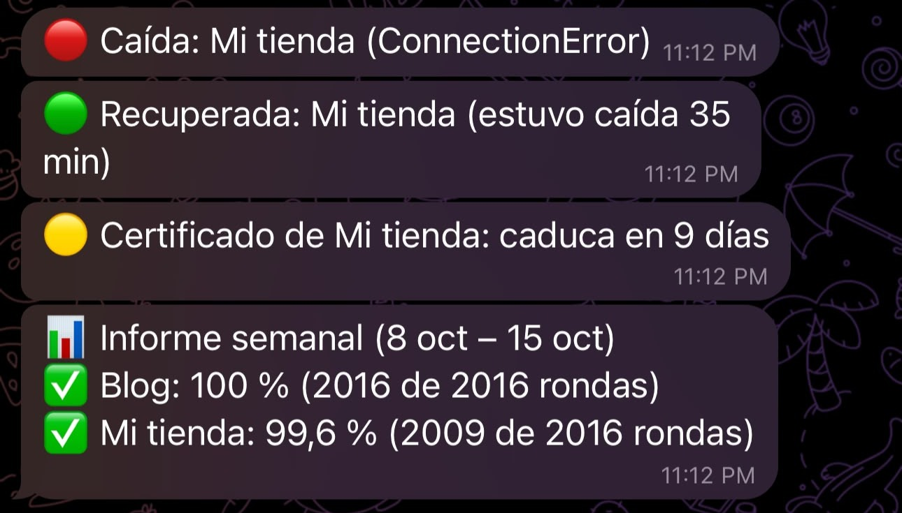

# Centinela

[](https://github.com/msa-ssh/centinela/actions/workflows/ci.yml)

Vigila tus webs y te avisa por Telegram antes de que tus clientes noten que algo falla.

Centinela revisa cada pocos minutos que tus webs respondan, que muestren lo que deben (por ejemplo, el botón "Añadir al carrito") y que su certificado HTTPS no esté a punto de caducar. También vigila el disco, la RAM y la carga del servidor donde se ejecuta. Solo te escribe cuando algo cambia: cuando una web cae, cuando se recupera y, si sigue caída, con un recordatorio cada pocas horas. Y cada lunes te manda un informe con el porcentaje de tiempo que cada web estuvo disponible.

## Cómo se ve un aviso



```
🔴 Caída: Mi tienda (ConnectionError)
🔴 Caída: Mi tienda (falta el texto «Añadir al carrito»)
🔴 Sigue caída: Mi tienda desde 2026-10-15T08:00:00 (ConnectionError)
🟢 Recuperada: Mi tienda (estuvo caída 35 min)
🟡 Certificado de Mi tienda: caduca en 9 días
🟠 Disco / de Servidor web al 93,5 % (límite 90 %)
🟢 Disco / de Servidor web vuelve al 71 %
📊 Informe semanal (8 oct – 15 oct)
✅ Blog: 100 % (2016 de 2016 rondas)
✅ Mi tienda: 99,6 % (2009 de 2016 rondas)
```

El porcentaje se redondea hacia abajo: una web con un solo fallo en la semana nunca aparece al 100 %.

## Instalación con Docker

Necesitas Docker con el plugin `compose` y un bot de Telegram (créalo con [@BotFather](https://t.me/BotFather)).

```bash
git clone https://github.com/msa-ssh/centinela.git
cd centinela
cp .env.example .env
cp config.example.toml config.toml
chmod 600 .env
```

Rellena `.env` y `config.toml` (ver [Configuración](#configuración)) y arranca:

```bash
docker compose up -d
docker compose logs -f
```

El contenedor se ejecuta con un usuario sin privilegios, se reinicia solo y guarda su estado y su historial en un volumen de Docker. El informe semanal lo envía el propio contenedor cada lunes a las 9:00, en la zona horaria de `TZ`.

Dentro de un contenedor, la RAM y la carga que se ven son las de la máquina anfitriona, y el disco `/` es el que usa Docker para sus datos. Para vigilar con precisión los discos de un servidor, usa la instalación con systemd.

## Alternativa con systemd

Sin Docker, en cualquier Linux con Python 3.11 o superior:

```bash
git clone https://github.com/msa-ssh/centinela.git ~/proyectos/centinela
cd ~/proyectos/centinela
python3 -m venv .venv
.venv/bin/pip install -r requirements.txt
cp .env.example .env && cp config.example.toml config.toml && chmod 600 .env
.venv/bin/python -m centinela --prueba
```

Las plantillas de `deploy/systemd/` son unidades de usuario, sin `sudo`: `centinela.timer` ejecuta una revisión cada 5 minutos y `centinela-informe.timer` envía el informe semanal los lunes a las 9:00 (si el equipo estaba apagado, al arrancar):

```bash
mkdir -p ~/.config/systemd/user
cp deploy/systemd/centinela*.service deploy/systemd/centinela*.timer ~/.config/systemd/user/
systemctl --user daemon-reload
systemctl --user enable --now centinela.timer centinela-informe.timer
loginctl enable-linger "$USER"
```

Los registros se leen con `journalctl --user -u centinela` y `journalctl --user -u centinela-informe`.

## Configuración

`.env` guarda las credenciales de Telegram y la zona horaria, y nunca se sube a Git:

```
TELEGRAM_TOKEN=123456:ABC...
TELEGRAM_CHAT_ID=123456789
TZ=UTC
```

`TZ` es la zona horaria de quien recibe los avisos (por ejemplo `Europe/Madrid`; ver la [lista de zonas](https://en.wikipedia.org/wiki/List_of_tz_database_time_zones)). Distingue mayúsculas: si está mal escrita, se usa UTC sin avisar.

`config.toml` define qué webs vigilar y cuándo avisar:

| Clave | Qué hace |
| --- | --- |
| `intervalo_minutos` | Minutos entre revisiones en modo `--bucle` (Docker) |
| `timeout_segundos` | Tiempo máximo de espera por web |
| `dias_aviso_certificado` | Avisa si el certificado caduca en menos días |
| `horas_entre_avisos_certificado` | Horas entre avisos del mismo certificado |
| `horas_recordatorio_caida` | Horas entre recordatorios de una web caída (0 los desactiva) |
| `dias_historial` | Días que se guardan en `historial.db` para el informe (90 si falta) |

Cada web es un bloque `[[sitio]]` con `nombre` y `url`. Con `texto`, además, la web cuenta como caída si responde pero su HTML no contiene ese texto (distingue mayúsculas; elige un texto que aparezca tal cual en el código fuente de la página):

```toml
[[sitio]]
nombre = "Mi tienda"
url = "https://mitienda.example"
texto = "Añadir al carrito"
```

Para vigilar el servidor donde corre Centinela, añade al final una tabla `[servidor]`. Sin ella, no se mide nada:

```toml
[servidor]
nombre = "Servidor web"
discos = ["/"]
disco_max = 90
ram_max = 90
carga_max = 100
```

| Clave | Qué hace |
| --- | --- |
| `nombre` | Nombre del servidor en los avisos |
| `discos` | Rutas cuyo disco se vigila (`["/"]` si falta) |
| `disco_max` | Porcentaje de disco usado a partir del cual avisa (90 si falta) |
| `ram_max` | Porcentaje de RAM usada a partir del cual avisa (90 si falta) |
| `carga_max` | Carga media de 5 minutos dividida entre los núcleos, en porcentaje (100 si falta) |

Avisa al pasar el límite, recuerda cada `horas_recordatorio_caida` si sigue alto y avisa cuando vuelve a la normalidad. Cada revisión deja en el registro una línea como `🖥️ Servidor web: Disco / 46,5 %, RAM 40,9 %, Carga 6,1 %`.

## Uso

```bash
python -m centinela            # una revisión
python -m centinela --bucle    # revisa cada intervalo_minutos, sin fin
python -m centinela --prueba   # envía un mensaje de prueba
python -m centinela --informe  # envía ahora el informe de los últimos 7 días
```

## Desarrollo

```bash
pip install -r requirements-dev.txt
ruff check .
pytest
```

## Hoja de ruta

- Más canales de aviso: correo y Discord.
- Vigilar varios servidores desde un solo Centinela.
- Recursos del servidor en el informe semanal.
- Zona horaria por web, para vigilar a clientes de varios países.
- Página de estado pública.

## Licencia

[MIT](LICENSE)
